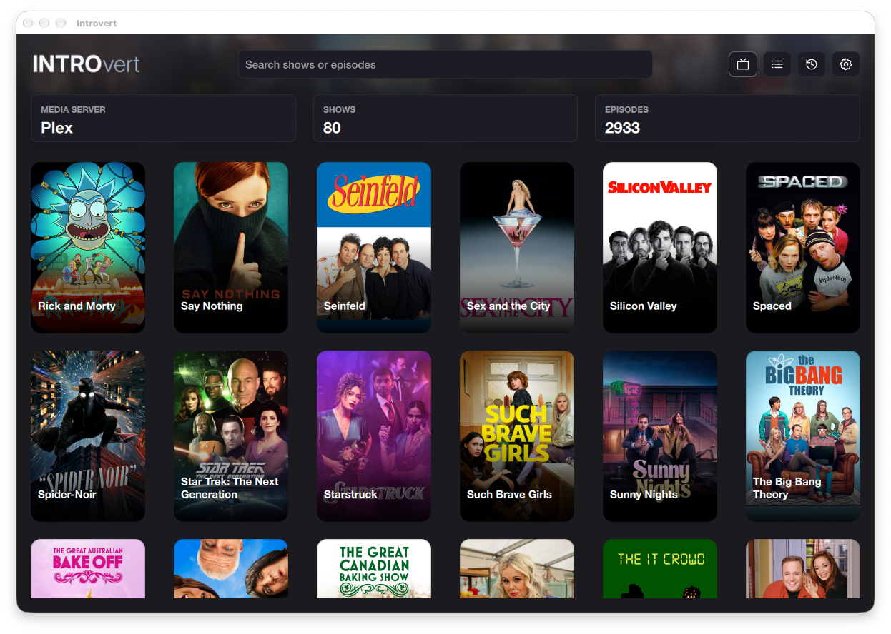
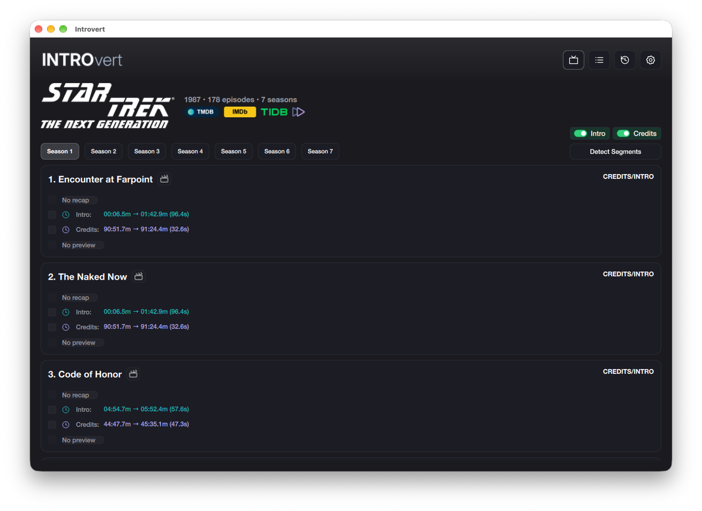
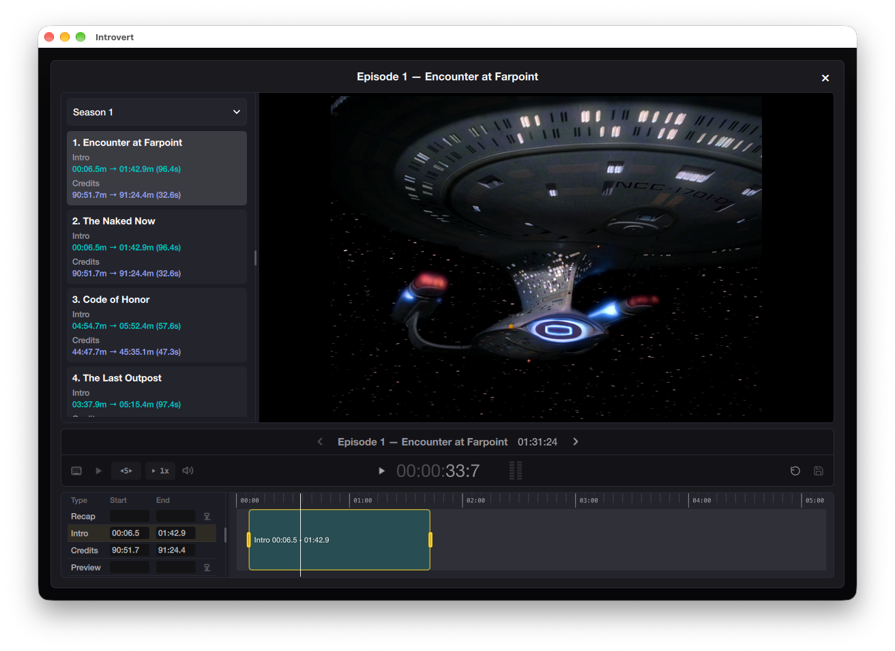

# Introvert

Introvert is a desktop application for detecting, reviewing, and editing TV
episode segment timestamps. It combines automated intro and credits detection
with a video editor for manually matching segment boundaries to the exact frames
of an episode.

  
  
  

Automated detection compares recurring audio across episodes in a season to find
intros and credits. Optional visual refinement checks nearby video transitions
to improve segment boundaries. Review the results against the original video
before sharing.

The video editor supports frame-by-frame navigation, a zoomable timeline, audio
levels, and precise timestamp entry. These controls make it possible to check
exactly where a segment starts and ends, correct a detection result, or create
timestamps entirely by hand. Recap, Intro, Credits, and Preview segments can all
be edited, with keyboard shortcuts and episode navigation keeping the review
workflow close to the video.

Introvert also brings the surrounding timestamp workflow into one application:

- **Media libraries:** Browse episodes from Plex, Emby, Jellyfin, or local media
  folders, including network storage.
- **Existing markers:** Import supported server markers and embedded chapter
  timestamps as a starting point for review.
- **Metadata and artwork:** Identify local shows and fetch their metadata and
  images from selectable providers in the background.
- **Community submissions:** Review and share selected timestamps with
  [IntroDB](https://introdb.app) and [TheIntroDB](https://theintrodb.org), with
  duplicate checks, queued processing, and submission history.
- **Timestamp management:** Organize and remove segments by show, season, or
  episode, and retain saved edits independently of later marker imports.

Timestamps and edits are stored locally. Reviewing and editing segments does not
rewrite the media files or change the markers on a connected media server.

## Table of contents

- [Quick start](#quick-start)
- [Installation](docs/installation.md): [macOS](docs/installation.md#macos), [Windows](docs/installation.md#windows), [Linux](docs/installation.md#linux)
- [Connect your media and configure metadata](docs/setup.md)
- [Run detection](docs/detection.md): [one season](docs/detection.md#one-season), [multiple seasons](docs/detection.md#multiple-seasons), [entire library](docs/detection.md#entire-library)
- [Review and edit timestamps](docs/editor.md)
- [Share timestamps, queue, and history](docs/sharing.md)
- [Settings, updates, backups, and troubleshooting](docs/help.md)
- [Detection performance](#detection-performance)
- [OS and CPU compatibility](#os-and-cpu-compatibility)

## Quick start

The detector is not bundled with the app. Install it separately before running
automated detection. Browsing, playback, and timestamp editing work without it.

1. [Install Introvert](docs/installation.md) for your operating system.
2. [Install the detector](docs/installation.md#install-the-detector): open
   **Settings → Application**, click **Check for Updates**, then click the green
   **Latest** version badge in the **Detector** row.
3. Open **Settings → Media** and [connect a server or local folder](docs/setup.md).
4. Return to **TV Shows**, open a show, and choose a season with at least two episodes.
5. Choose **Intro**, **Credits**, or both, then click **Detect Segments**.
6. Open an episode's video editor to [check and save any corrections](docs/editor.md).
7. Optionally, [submit selected timestamps](docs/sharing.md) to a community database.

## Detection performance

**Synthetic baseline for a complete 10-episode season**, detecting both Intro
and Credits at the default **Medium** effort setting. Media is stored on a local
SSD; times below are for the whole season.

| Season | Resolution | Audio only | With visual refinement |
| --- | --- | ---: | ---: |
| 10 × 30 min | 720p | ≈5.5 s | ≈6.3 s |
| 10 × 30 min | 1080p | ≈5.6 s | ≈7.1 s |
| 10 × 30 min | 4K | ≈7.7 s | ≈13.3 s |
| 10 × 60 min | 720p | ≈5.5 s | ≈6.3 s |
| 10 × 60 min | 1080p | ≈5.6 s | ≈7.2 s |
| 10 × 60 min | 4K | ≈7.7 s | ≈13.0 s |

Measured on a **Mac mini · Apple M6 · 12-core CPU · 16 GB RAM**, running
**macOS 27.2** (Introvert 0.1.17, detector 0.51.2). Each value is the rounded
median of three fresh-analysis runs using synthetic 24 fps H.264/AAC files with
repeated moving test-pattern video, generated music and quiet gaps. File generation
and library import are excluded; operating-system file caches were not flushed.

Thirty- and sixty-minute episodes both analyze the first and last ten minutes
of audio, so doubling episode length does not necessarily double detection time.

**Estimates only:** these simple synthetic files can be much faster to analyze
than real media. Results may vary drastically with hardware, codecs, bitrate,
frame rate, available memory, background load and network/server performance.
Visual refinement scanned one six-second boundary window per episode here;
other sequences may require more or less work.

## OS and CPU compatibility

| Operating system | CPU architecture | Testing status |
| --- | --- | --- |
| macOS | ARM64 (Apple Silicon) | Tested |
| macOS | x86_64 (Intel) | Tested |
| Windows | x86_64 | Not yet tested |
| Linux | x86_64, ARM64 | Not yet tested |

Only macOS has been tested at runtime. All internal tests pass, including build,
packaging, architecture and dependency checks for Windows and Linux. Native
runtime and installation testing on those platforms is still pending.
