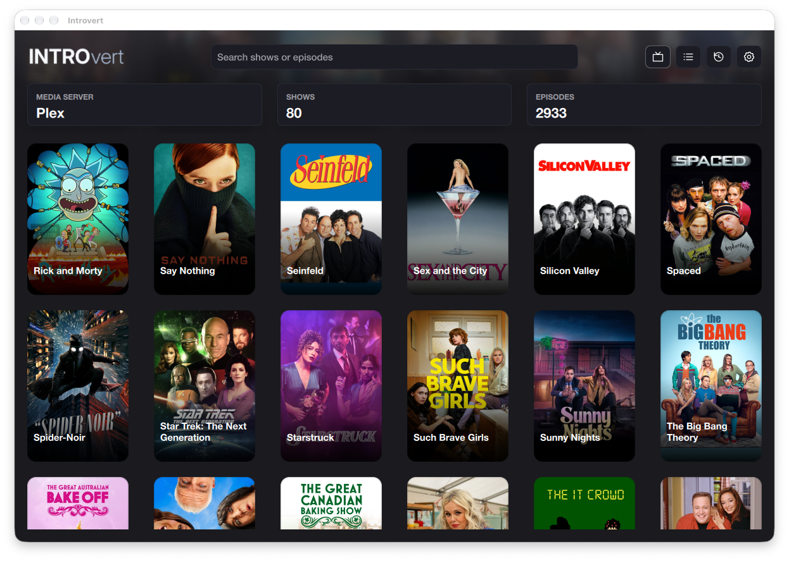
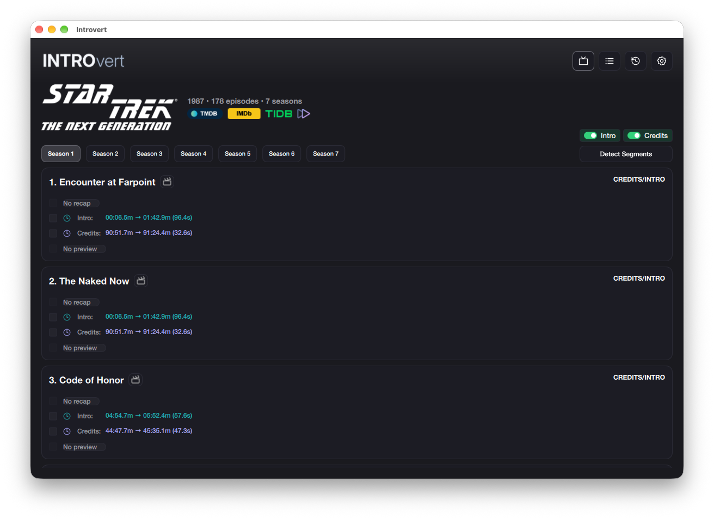
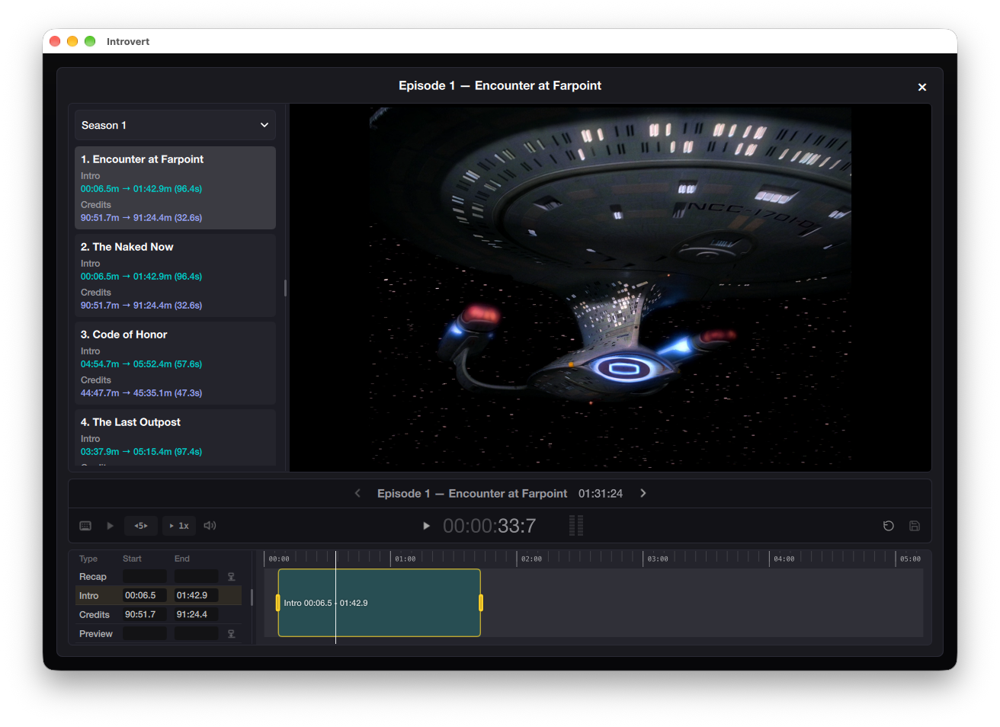

# INTROvert

INTROvert is a desktop application for detecting, reviewing, and editing TV
episode segment timestamps. It combines automated intro and credits detection
with a video editor for manually matching segment boundaries to the exact frames
of an episode.

  
  
  

Automated detection compares recurring audio across episodes in a season to find
intros and credits. Optional visual refinement helps refine intro boundaries and
the beginning of credits. Detected timestamps can be reviewed and adjusted
against the original video before they are shared.

The video editor supports frame-by-frame navigation, a zoomable timeline, audio
levels, and precise timestamp entry. These controls make it possible to check
exactly where a segment starts and ends, correct a detection result, or create
timestamps entirely by hand. Recap, Intro, Credits, and Preview segments can all
be edited, with keyboard shortcuts and episode navigation keeping the review
workflow close to the video.

INTROvert also brings the surrounding timestamp workflow into one application:

- **Media libraries:** Browse episodes from Plex, Emby, Jellyfin, or local media
  folders, including network storage.
- **Existing markers:** Import supported server markers and embedded chapter
  timestamps as a starting point for review.
- **Metadata and artwork:** Identify local shows and fetch their metadata and
  images from selectable providers in the background.
- **Community submissions:** Review and share selected timestamps with
  [IntroDB](https://introdb.app) and [TheIntroDB](https://theintrodb.org), with
  duplicate checks, queued processing, and submission history.
- **Timestamp management:** Organize and remove segments by show, season, or
  episode, and retain saved edits independently of later marker imports.

Timestamps and edits are stored locally. Reviewing and editing segments does not
rewrite the media files or change the markers on a connected media server.
